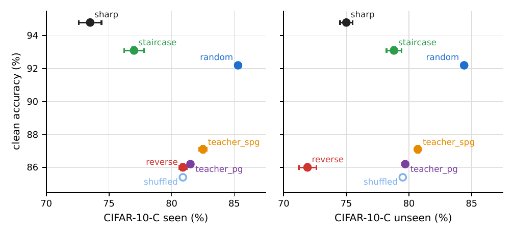
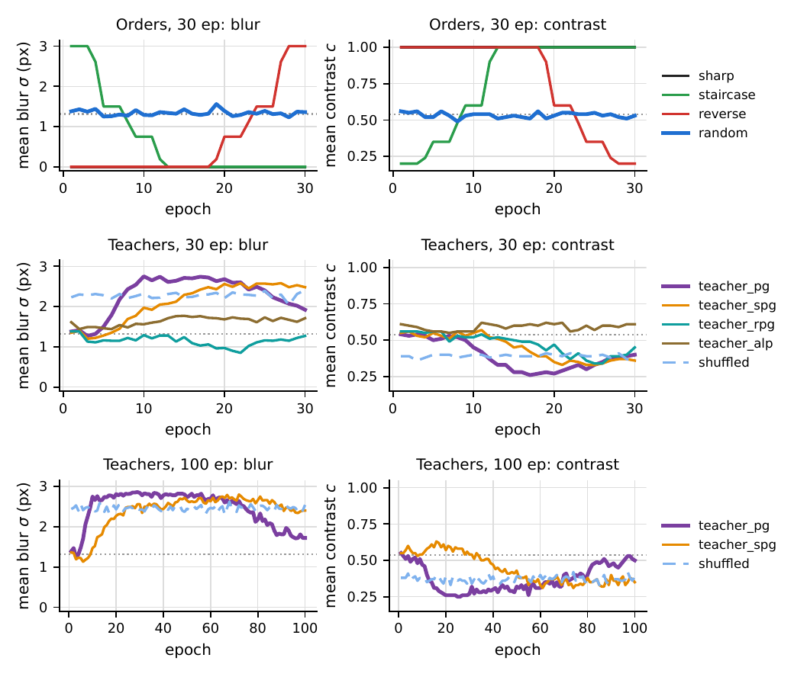

# autofocus-curriculum

A newborn sees the world blurry and with low contrast. Studies that train CNNs on a hand-made blurry-to-sharp schedule report more robustness. This project asks: **if the network chooses the blur and contrast of its own training images, based only on how fast it learns, does it start blurry like an infant? And does that make it more robust?**

Senior project (CMPE 492), Boğaziçi University, Department of Computer Engineering, 2026–27.
Ömer Faruk Çelik, Mustafa Taha Söylemez. Advisor: Prof. Şuayb S. Arslan.

## Status (November 2026)

- Midterm report submitted: [`docs/report/main-compact.pdf`](docs/report/main-compact.pdf) (28 pages). Long version: [`docs/report/main.pdf`](docs/report/main.pdf).
- Done: 7 main conditions × 3 seeds at 30 and 100 epochs; 13 extended conditions × 3 seeds at 30 epochs; shape-bias and PGD probes on all checkpoints.
- Next: see [Next steps](#next-steps).

## Set-up

- CIFAR-10, ResNet-18 (CIFAR form), SGD, 30 or 100 epochs, seeds 0–2.
- 16 arms: 4 blur levels (σ ∈ {0, 0.75, 1.5, 3} px) × 4 contrast levels (c ∈ {1, 0.6, 0.35, 0.2}). Each batch gets one arm.
- Teacher: Exp3.S bandit (Graves et al. 2017). The reward is learning progress on training data only. Robustness and shape bias never enter the reward; we measure them after training.
- Controls: `sharp`, uniform `random`, hand-made `staircase` (blurry → sharp), `reverse` (sharp → blurry), and `shuffled` (the teacher's arms in random order).
- Measures: clean accuracy, CIFAR-10-C (seen = blur and contrast corruptions, unseen = the other 13), a frequency-based shape-bias proxy, PGD-10.

## Main findings

1. **No teacher started blurry.** Seven teacher variants all start near uniform. With raw prediction gain the teacher moves to the most degraded arm (σ 3, c 0.2), where the loss drops most. Relative progress and ALP-GMM stay near uniform.
2. **Robustness follows exposure to blur, not order.** At 100 epochs, `random` is the best of the seven main conditions on CIFAR-10-C. The teacher's order adds no measurable robustness over the same arms shuffled (gaps below 1 point).
3. **Direction still matters.** `reverse` is the worst order (C-unseen 71.9, PGD 18.6).
4. **Blur gives the robustness, contrast does not** under batch-level training with BatchNorm. Contrast is learned only with per-image mixing or GroupNorm.



100 epochs, mean of 3 seeds, accuracy in %. Standard deviations are in the report appendix.

| Condition | Clean | C-seen | C-unseen | Shape bias | PGD-10 |
|---|---:|---:|---:|---:|---:|
| `sharp` | **94.8** | 73.5 | 75.0 | 4.7 | 44.9 |
| `staircase` | 93.1 | 77.0 | 78.8 | 12.2 | **57.8** |
| `reverse` | 86.0 | 80.9 | 71.9 | 10.9 | 18.6 |
| `random` | 92.2 | **85.3** | **84.4** | 23.5 | 56.6 |
| `shuffled` | 85.4 | 80.9 | 79.5 | **68.7** | 49.3 |
| `teacher_pg` | 86.2 | 81.5 | 79.7 | 66.6 | 48.5 |
| `teacher_spg` | 87.1 | 82.5 | 80.7 | 61.2 | 46.9 |

Mean blur and contrast that each condition trained on, per epoch. The staircase starts blurry by design. No teacher does.



## Next steps

- Run `random_image`, `random_blur`, `teacher_rpg` and `teacher_alp` at 100 epochs.
- A per-image teacher (a distribution over arms for each batch).
- A transfer-progress reward: the loss drop on a clean validation batch.
- A per-arm reward analysis, to test why raw prediction gain goes to the hardest arm.

## Code

| Path | Contents |
|---|---|
| `src/degrade.py` | Blur and contrast on the GPU |
| `src/teacher.py`, `src/teacher_alp.py` | Exp3.S (PG, SPG, RPG) and ALP-GMM teachers |
| `src/schedule.py` | Fixed schedules: sharp, random, staircase, reverse, shuffled |
| `src/train.py`, `src/eval.py` | Training and CIFAR-10-C evaluation (with BatchNorm recalibration) |
| `src/probe.py` | Shape-bias proxy, high-pass accuracy, PGD |
| `src/collect.py`, `src/digest.py` | Result tables |
| `configs/short`, `configs/full` | One config per condition and seed (30 / 100 epochs) |
| `colab/` | Colab launcher and batch scripts |
| `docs/experiments.md` | Experiment log |

Run on Colab: [`colab/README.md`](colab/README.md). Local tests (CPU):

```bash
python -m pytest -q tests
```
